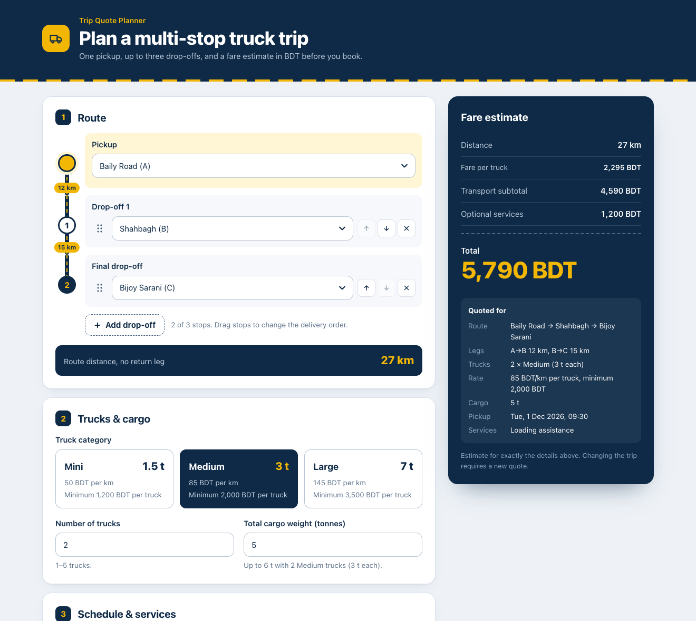

# Multi-Stop Trip Quote Planner

Angular 18 single-page app for a fictional logistics service: configure a truck trip with one pickup and up to three ordered drop-offs, get an asynchronous fare estimate, and save an unfinished trip as a local draft. No backend, maps or external APIs.



## Environment

| Tool | Version used |
| --- | --- |
| Node.js | 20.20.2 (Angular 18 supports `^18.19.1 \|\| ^20.11.1 \|\| ^22.0.0`; `.nvmrc` pins 20) |
| npm | 10+ |
| Angular / CLI | 18.2.x |
| Angular CDK | 18.2.x (drag-and-drop) |
| TypeScript | 5.5 |
| Tests | Karma + Jasmine, Chrome / ChromeHeadless |

## Setup, run, test

```bash
nvm use            # or any Node 18.19+/20.11+/22 install
npm install
npm start          # http://localhost:4200
npm run test:ci    # single headless run (35 specs)
npm test           # watch mode in Chrome
npm run build      # production build → dist/
```

Tests need a local Chrome or Chromium. If it isn't auto-detected, set `CHROME_BIN` to its path.

## What it does

- **Route:** pickup + 1–3 drop-offs, drawn as a road with each leg's distance. Reorder by dragging the handle (or ↑/↓ for keyboard). A location can't be used twice.
- **Trucks & cargo:** Mini / Medium / Large, 1–5 trucks, weight checked against total capacity.
- **Schedule & services:** pickup must be later than now — checked again when you request a quote; optional loading (600 BDT/truck) and unloading (400 BDT/truck).
- **Fare estimate:** distance, transport subtotal, services subtotal and total, plus a summary of exactly what was quoted. Example A → B → C, 2 × Medium, 5 t, loading → **5,790 BDT**.
- **Drafts:** save anytime (even incomplete), restored on reload, clear to start again. Quotes are never restored.

## Project structure

```
src/app/
  core/
    models/      typed domain: LocationId, TripDraft, TripRequest, QuoteState…
    data/        locations, distance table, truck categories, fees
    domain/      pure logic: pricing, route distance, trip rules, date/time, trip key
    services/    QuoteService (async, injectable latency), Clock
    draft/       DraftStorageService, draft sanitizer
  features/trip-planner/
    trip-planner.component     container: form, actions, wiring
    route-stops/               pickup + drop-offs, drag-and-drop
    quote-panel/               presentational fare panel
    trip-form*.ts              form factory, validators, error messages
    quote.store.ts             latest-request-wins state
    quote-view.ts              what the panel shows (pure)
  shared/bdt.pipe.ts
src/testing/test-doubles.ts    FakeClock, MemoryStorage, latency sequences
docs/                          PRD, spec, plan, implementation notes, screenshots
```

## Main technical decisions

Full reasoning in [docs/04-IMPLEMENTATION-NOTES.md](docs/04-IMPLEMENTATION-NOTES.md).

1. **Framework-free domain layer** (`core/domain`) used by both the form validators and the quote service, so rules are tested once and can't diverge.
2. **`TripDraft` vs `TripRequest`:** only a valid form can produce a `TripRequest`, and only a `TripRequest` can be priced.
3. **Latest request wins:** `QuoteStore` routes requests through `switchMap` (an older response is unsubscribed and can never land) plus a request-id guard. `startWith(pending)` keeps the spinner tied to the latest request.
4. **Quotes carry their inputs.** A quote is displayed only if its input fingerprint equals the current form's **and** the form is valid now; otherwise it's shown as outdated with the figures hidden.
5. **Injected time:** `Clock`, `QUOTE_LATENCY` and `QUOTE_SCHEDULER` tokens make async and time-based behaviour deterministic under `fakeAsync` — no real waiting in tests.
6. **Defensive drafts:** versioned payload; unreadable data discarded, otherwise each field validated and repaired individually with a message to the user.
7. **Angular CDK** for drag-and-drop; signals + `form.events` for derived view state; fonts bundled locally so the app makes no network requests.

## Significant issues encountered

- Default Node 24 is outside Angular 18's supported range → pinned Node 20 (`.nvmrc`, `engines`).
- Pickup time can expire without any input event → explicit re-validation at request time, on an interval, on focus and after restore.
- `Date` silently normalises invalid dates (Feb 31) → strict manual parsing of `datetime-local` values.
- `NG0956` list re-creation warnings → reuse form controls when applying a draft; track message lists by index.

More in the [implementation notes](docs/04-IMPLEMENTATION-NOTES.md#issues-encountered).

## How correctness was verified

- **35 automated specs** covering the pricing example and edge cases, validation, draft sanitising, out-of-order async responses in both directions, stale-quote display, and full component flows. See the [verification table](docs/04-IMPLEMENTATION-NOTES.md#verification).
- **Manual run in Chrome:** dragged stops to reorder, reproduced 5,790 BDT, saved and reloaded the draft, checked the 390 px layout and the console for errors.

## Documentation (spec-driven)

| Doc | Contents |
| --- | --- |
| [01-PRD.md](docs/01-PRD.md) | Problem, goals, scope, numbered requirements, acceptance criteria |
| [02-SPEC.md](docs/02-SPEC.md) | Architecture, data model, rules, async design, drafts, UI states, traceability matrix |
| [03-PLAN.md](docs/03-PLAN.md) | Ordered implementation steps with status and definition of done |
| [04-IMPLEMENTATION-NOTES.md](docs/04-IMPLEMENTATION-NOTES.md) | Decisions, issues, verification |

## AI tools disclosure

<!-- Candidate: review and edit this section so it accurately reflects your own process before submitting. -->

- **Tool used:** Claude Code (Anthropic's Claude) as a coding assistant, for scaffolding, implementation, tests, styling and documentation drafts.
- **What I reviewed and tested myself:**
  - Checked the pricing formulas and the verification example (27 km, 4,590 + 1,200 = 5,790 BDT) by hand against the brief.
  - Read through the async design (`QuoteStore`, `deriveQuoteView`) and the out-of-order tests to confirm the latest-request-wins and stale-quote rules.
  - Ran `npm run test:ci` and `npm run build` locally.
  - Used the app in the browser: drag-and-drop reordering, validation messages, pending/outdated states, saving, reloading and clearing drafts, and a tampered draft in localStorage.
